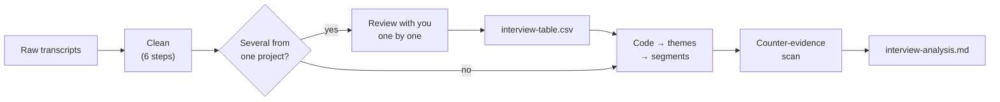

# Interview Analysis Skill

An agent skill for turning raw interview transcripts into evidence-backed research conclusions. It cleans the transcripts first, then performs thematic coding, groups participants by the positions they hold, and extracts actionable insights — each one traceable back to a specific participant turn and a verbatim quote.

It is useful after fieldwork and before product decisions, when a team has a pile of transcripts and needs conclusions that survive the question "how do you know that?"

Output is written in Traditional Chinese (繁體中文). Input can be Mandarin transcripts in Traditional or Simplified characters, including mixed Chinese–English speech.

## What this skill can achieve

- Clean raw transcripts before any analysis: fix speaker misattribution (orphaned acknowledgments, misplaced questions), correct homophone and mangled-English ASR errors against a project glossary, convert Simplified to Traditional characters without changing the speaker's words, remove ASR hallucinations, de-identify, and number every turn so each quote traces back to its exact source. This step can also run on its own.
- When a project has several transcripts, review them with you one at a time — cleaning summary, open questions, new glossary terms, and the rows each one adds — and build one consolidated table (`interview-table.csv`, UTF-8 with BOM so Excel opens it cleanly; it also imports into Google Sheets or Notion).
- Perform three-level thematic coding: open coding to break the data apart, axial coding to group it into themes, selective coding to keep only what answers the research question.
- Build a codebook where every code carries a definition, inclusion and exclusion rules, participant count, mention count, and a representative verbatim quote.
- Separate participant count from mention count, so one talkative participant is never mistaken for a pattern.
- Group participants by the positions they hold rather than by demographics, and state explicitly where those groups disagree.
- Run a counter-evidence scan on every theme: who said the opposite, who stayed silent, who contradicted themselves, and which single-participant views are worth keeping anyway.
- Grade each insight by evidence strength, distinguishing behavioral evidence from opinion and from hypothetical answers.
- Report saturation honestly, including when the sample was too small to reach it.
- Label pain points with the same failure-mode vocabulary used by the companion user-story, user-flow, and sitemap skills, so the four documents read as one system.

## What it produces

First, a `cleaned/` folder: one analysis-ready transcript per interview, each ending with a cleaning log, plus an overview listing the glossary, de-identification rules, topic list, and any items that need your confirmation. With several transcripts, an `interview-table.csv` is built alongside it, one row per participant and topic. A cleaning-only run stops here.

Then a single Markdown document, `interview-analysis.md`, containing:

1. **Analysis goal and method** — the research question, the track taken, sample size, saturation status, and limitations.
2. **A codebook** — the thematic coding table, with counts and quotes.
3. **Themes** — each stated as a claim that can be challenged, not as a label.
4. **Segments** — participants grouped by position, with the disagreements between groups made explicit.
5. **Actionable insights** — each written as *observation → interpretation → action*, with evidence strength, counter-evidence, scope of impact, and a recommended next action.
6. **Counter-evidence and contradictions** — kept in the document rather than edited out.
7. **Assumptions and coverage** — including which topics produced no data and who still needs to be interviewed.

The output describes what participants actually said and what follows from it. It does not write product specs, feature lists, screen flows, or acceptance criteria.

## How it runs



| Mode | How to trigger it | What you get |
|---|---|---|
| Full analysis | Default for a single transcript | `cleaned/` and `interview-analysis.md` |
| One-by-one review | Default for two or more transcripts from the same project | After each transcript, the skill stops for your confirmation before adding its rows to `interview-table.csv`. When all are confirmed, it asks whether to continue to analysis |
| Cleaning only | Say 「先清理」 or 「只要清理」 | `cleaned/`, plus `interview-table.csv` if there are several transcripts |
| Straight through | Say 「直接跑完」 | No review stops; uncertain items are marked and listed under limitations |

Adding interviews to an existing project later continues the numbering (P04, P05, …) and reuses the confirmed glossary and topic list.

### Cleaning steps

Cleaning comes first because its errors propagate: a sentence credited to the wrong speaker corrupts participant counts, and an uncorrected homophone splits one code into two.

| Step | What it fixes |
|---|---|
| 1. Inventory sources | Identifies the ASR tool and format, since each has typical problems. Raw files are never edited |
| 2. De-identify | Direct identifiers (names, phone numbers) and indirect ones (job titles, companies, exact dates). Every replacement is bracketed, never silent |
| 3. Correct speakers | Four misattribution patterns, such as an interviewer's 「好，了解」 stranded at the end of a participant's turn |
| 4. Correct ASR errors | Homophones against a shared glossary (排程[原：拍成]), English turned into characters (Line[原：來恩]), Simplified→Traditional that changes characters but never words, and hallucinated text in silent stretches |
| 5. Preserve language | Keeps code-switching, Taiwanese, particles, hesitation, and self-corrections exactly as spoken |
| 6. Segment and restructure | Adds full-width punctuation without adding or removing words, merges fragmented turns, and numbers every turn (`P01-T010`) |

## Two tracks

- **Track B (exploratory, default)** — no framework supplied. Codes emerge from the transcripts.
- **Track A (framework-led)** — a research question, hypothesis, or existing codebook is supplied. The framework is applied first, then open coding fills the gaps. Track A requires a separate section listing what the framework failed to anticipate; without it, the analysis only confirms what was already believed.

## Recommended input

- One or more interview transcripts (`.txt`, `.md`, `.docx`, `.vtt`, `.srt`, or pasted text). Raw ASR exports work best; transcripts already tidied by hand have often been rewritten, which damages quote fidelity.
- Optionally: a list of product and feature names, used to correct homophone errors during cleaning.
- Optionally: the discussion guide, which becomes the topic list for the consolidated table.
- Optionally: the research question, a participant background table, or an existing codebook.

The skill runs on as little as one transcript, but marks small samples as provisional and caps evidence strength accordingly.

## Example requests

Requests can be written in Chinese or English.

> 這 5 份是同一個專案的訪談逐字稿，一份一份跟我確認，最後整理成一張表。產品名稱有：排程、上架、桌布。

> 幫我分析這 8 份訪談，研究問題是：編輯在排程與發布時卡在哪。

> 先幫我清理這份逐字稿就好，不用分析。

For a complete walkthrough — from a messy Simplified-character ASR export with homophones and a misattributed turn, through cleaning, to a codebook, segments, and an insight — see [`examples/worked-example.md`](examples/worked-example.md).

## What this skill deliberately does not do

- **No inter-rater reliability.** This is a single-analyst workflow; computing Cohen's Kappa with one coder is false rigor. Credibility rests on traceability and counter-evidence scanning instead.
- **No academic reporting standards** (COREQ, SRQR). This is product research, not a methods chapter.
- **No invented quotes.** Quotes are verbatim, never polished, never merged across participants. Anything that cannot be traced to a participant is moved to assumptions or dropped.
- **No filler-word stripping.** English transcript cleaners delete fillers by word list. In Mandarin the commonest fillers are also content words — 「對」 is often the answer itself, 「那個」 means "that" — and hesitation shows how sure the speaker is. Cleaning removes only ASR hallucinations, platform artifacts, and pure connection small talk, judged by the whole exchange, never by word list.

## Boundaries with the companion skills

`interview-analysis`, `user-story`, `user-flow`, and `sitemap` are independent — they never read each other's files. They share one `failure_mode` vocabulary (each keeps its own identical copy) so the four documents use consistent terms when read side by side.

| Skill | Layer | Answers |
|---|---|---|
| **interview-analysis** | Evidence | What did they say, and what do we therefore know? |
| user-story | Intent | Who wants what, and why? |
| user-flow | Mechanism | What are the steps, states, and failure branches? |
| sitemap | Structure | What pages exist, and how do they nest? |

For example, "6 of 8 participants re-check the live site after scheduling" is interview evidence. "As an editor, I want to confirm a schedule took effect so that I don't hear about failures from clients" is a user story built on that evidence.

## Installation

For Claude Code, copy this folder to your personal skills directory:

```bash
git clone https://github.com/bonny8000/Interview-Analysis-Skill.git ~/.claude/skills/interview-analysis
```

The skill is then available as `interview-analysis` in every session. To update, run `git pull` inside that folder.

## Repository structure

```text
.
├── SKILL.md                                  # Agent operating manual
├── README.md                                 # This overview and usage guide
├── CHANGELOG.md                              # Version history
├── LICENSE                                   # MIT license
├── references/
│   ├── transcript-cleaning.md                # Step 1: the six cleaning steps
│   ├── review-workflow.md                    # One-by-one review and the consolidated table
│   ├── coding-method.md                      # Open, axial, and selective coding; saturation
│   ├── code-catalog.md                       # Code dimensions and the shared failure-mode vocabulary
│   └── insight-quality-rules.md              # Evidence strength, counter-evidence, and quote rules
├── templates/
│   ├── cleaned-transcript.template.md        # Cleaned transcript and cleaning overview
│   ├── interview-table.template.csv          # Consolidated table header (UTF-8 with BOM)
│   └── interview-analysis.template.md        # Analysis report scaffold
└── examples/
    └── worked-example.md                     # Raw ASR export → cleaned transcript → insights
```

## Quality characteristics

A strong result should make it possible to answer:

- Can every quote be found, word for word, in the cleaned transcript under its turn number?
- What changed during cleaning, and was anything removed that might have mattered?
- How many people said this — not how many times was it said?
- Where do participants disagree, and who said the opposite?
- Is this something they did, or only something they said they would do?
- Which topics produced no data, and who still needs to be interviewed?

## License

MIT — see [`LICENSE`](LICENSE).
